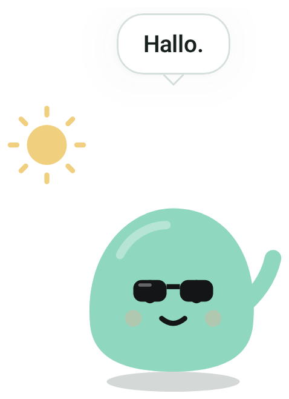

# Patch

<p align="center">
  
</p>

Patch is my friend in my personal projects: a small mint blob that keeps me company wherever an app has a moment to spare. An empty state, a status screen, a quiet corner of a dashboard: Patch shows up, says something, and makes the app feel a little less like a tool.

Each time Patch comes into view, it pops up with a speech bubble line and plays one move. What Patch wears follows the weather and time of day, and optionally the season or a Dutch holiday; its face follows a mood.

Plain TypeScript and CSS. No framework, no runtime dependencies, no build step: the package ships its TypeScript source for your bundler (esbuild, Vite, …) to compile.

## Install

```json
"dependencies": {
  "@jblaak/patch": "github:JBlaak/Patch#v0.6.0"
}
```

## Use

```ts
import { mountPatch } from '@jblaak/patch';
import '@jblaak/patch/patch.css';

const patch = mountPatch(document.getElementById('empty-state')!);

patch.appear({
  move: 'wave',
  mood: 'happy',
  line: 'Hi! 2 sessions running smoothly.',
  time: 'day',
  sky: 'clear', // or null when the weather is unknown
  season: 'autumn', // optional
  holiday: null,    // optional, e.g. 'koningsdag'
});

// later
patch.destroy();
```

## API

```ts
type PatchMove = 'wave' | 'hop' | 'twirl' | 'peek' | 'doze' | 'jelly' | 'love' | 'stretch';
type PatchMood = 'calm' | 'happy' | 'worried' | 'frazzled' | 'tired';
type PatchSky = 'clear' | 'cloudy' | 'rain' | 'snow';
type PatchTime = 'morning' | 'day' | 'evening' | 'night';
type PatchSeason = 'spring' | 'summer' | 'autumn' | 'winter';
type PatchHoliday =
  | 'oud-en-nieuw' | 'carnaval' | 'valentijnsdag' | 'pasen' | 'koningsdag'
  | 'bevrijdingsdag' | 'halloween' | 'sint-maarten' | 'sinterklaas' | 'kerst';

interface PatchScene {
  move: PatchMove;
  mood: PatchMood;
  line: string;                   // speech bubble text, set via textContent
  time: PatchTime;
  sky?: PatchSky | null;          // null/undefined: dress by time of day only
  season?: PatchSeason | null;    // null/undefined: no season, dress by weather as below
  holiday?: PatchHoliday | null;  // wins over the season while set
}

interface PatchHandle {
  appear(scene: PatchScene): void; // (re)enter with this scene; replays the move and bubble pop
  destroy(): void;                 // remove Patch's DOM
}

interface PatchOptions {
  onPoke?: () => void;              // called on click, tap or Enter/Space
  onGrab?: () => void;              // called when a press turns into a drag
  onDrop?: (fling: Fling) => void;  // called on let-go; { distance (px), speed (px/ms) }
}

function mountPatch(container: HTMLElement, options?: PatchOptions): PatchHandle;
```

With any of these, Patch is a real `<button aria-label="Poke Patch">` that squishes on hover and press; answer a poke with another `appear`, and keyboard focus stays on Patch across it.

Patch can also be dragged: it trails the pointer on a spring, the leash stretches the further it is pulled, it tilts with its direction and stretches with speed, and makes a surprised face. Let go, it springs home with an overshoot and a wobble. A press that moved is a drag, not a poke. Answering `onDrop` with an `appear` does not cut the way home short. With reduced motion Patch still follows the pointer but snaps home without the wobble. `--patch-focus` sets the focus ring colour (default: the body colour).

Nothing shows until the first `appear`. A move plays once per `appear`; breathing and blinking loop.

## Dressing

| Sky | Time | Patch gets |
| --- | --- | --- |
| `clear` | `night` | moon, twinkling stars, nightcap |
| `clear` | any other | turning sun, sunglasses |
| `cloudy` | any | drifting cloud |
| `rain` | any | falling drops, umbrella |
| `snow` | any | falling flakes, scarf |
| unknown | `night` | moon, twinkling stars, nightcap |
| unknown | `morning` | steaming mug |
| unknown | `day`, `evening` | nothing extra |

That is the dressing without a `season` or `holiday`. Patch does not work out the season or the holidays itself: the host passes them in.

### Seasons

With a `season` (and no `holiday`) the season's kit replaces the outfit above. The weather only adds its sky: drops in rain, flakes in snow, the sun in clear weather (the moon at `night`), a cloud when cloudy. There is no umbrella, nightcap or morning mug. At `night` the sunglasses and the butterfly stay home. With the sky unknown, Patch gets the season's own kit and the moon at night.

| Season | Always | `clear` | `cloudy` | `rain` | `snow` |
| --- | --- | --- | --- | --- | --- |
| `spring` | tulip, drifting petals | butterfly | | rainbow | |
| `summer` | | sunglasses, ice cream | sunglasses | puddle | sunglasses |
| `autumn` | falling leaves, leaves on the ground | | | sou'wester | scarf |
| `winter` | beanie, scarf | steaming mug | | | |

### Holidays

A `holiday` wins over the season: its kit replaces the season's. Rain and snow still fall. Some holidays bring their own sky and push the sun, cloud and moon out; the others still get the sky as with a season.

| Holiday | Patch gets | Own sky |
| --- | --- | --- |
| `oud-en-nieuw` | party hat, fireworks, confetti, oliebol | yes |
| `carnaval` | jester's hat, confetti | yes |
| `valentijnsdag` | rising hearts, extra blush | no |
| `pasen` | bunny ears, painted egg | no |
| `koningsdag` | crown, bunting, orange body | yes |
| `bevrijdingsdag` | Dutch flag | no |
| `halloween` | witch's hat, pumpkin, bats | yes |
| `sint-maarten` | lantern, beanie, moon | yes |
| `sinterklaas` | mitre, falling pepernoten, klomp with a carrot | no |
| `kerst` | Santa hat, string lights, tree | yes |

At the usage limit (`tired`) a seasonal or holiday Patch takes its props off: hats, ears, the flag, the lantern, the ice cream, the props on the ground and the orange body. The sky and the scenery around it (leaves, petals, confetti, hearts, bunting, lights, …) stay. Without a season or holiday, `tired` dresses as in the first table.

| Mood | Face |
| --- | --- |
| `calm` | nothing extra |
| `happy` | stronger blush |
| `worried` | brows, sweat drop, frown |
| `frazzled` | sweat drop |
| `tired` | half-closed lids, flat mouth, dimmer body |

## Theming

Every colour is a custom property with a dark default, set on `.patch`. Override them in your own stylesheet to match your theme:

| Variable | Default | Used for |
| --- | --- | --- |
| `--patch-body` | `#8fd8bf` | body, arm, z's |
| `--patch-body-tired` | `#5e9e88` | body when `tired` |
| `--patch-ink` | `#141517` | eyes, mouth, brows, sunglasses |
| `--patch-cheek` | `#eeab94` | cheeks, heart |
| `--patch-sun` | `#f0cf7e` | sun, moon, sparkles |
| `--patch-rain` | `#9cc5e8` | rain, umbrella, sweat drop |
| `--patch-scarf` | `#ee8b8b` | scarf, mug |
| `--patch-cap` | `#c8b8e8` | nightcap |
| `--patch-cloud` | `#3a3b40` | cloud |
| `--patch-snow` | `#ecebe8` | snowflakes, stars, pompom, steam |
| `--patch-pole` | `#a09e99` | umbrella pole |
| `--patch-highlight` | `rgba(255,255,255,0.35)` | body sheen, glint on the shades and mug |
| `--patch-bubble-bg` | `#212226` | speech bubble |
| `--patch-bubble-text` | `#ecebe8` | speech bubble text |
| `--patch-bubble-edge` | `rgba(255,255,255,0.07)` | speech bubble edge |
| `--patch-bubble-shadow` | `rgba(0,0,0,0.7)` | speech bubble drop shadow |
| `--patch-shadow` | `rgba(0,0,0,0.35)` | ground shadow |
| `--patch-font` | `inherit` | bubble text and z's |
| `--patch-body-koningsdag` | `#f6a95e` | body on `koningsdag` |
| `--patch-leaf-a` | `#e8955a` | autumn leaves |
| `--patch-leaf-b` | `#d9694f` | autumn leaves |
| `--patch-leaf-c` | `#e3b94f` | autumn leaves |
| `--patch-petal` | `#f4bccb` | petals, butterfly, ice cream |
| `--patch-tulip` | `#ee7b8b` | tulip |
| `--patch-stem` | `#6fbf8f` | stems, rainbow, tree, confetti, lights |
| `--patch-orange` | `#f39a3c` | bunting, pumpkin, lantern, carrot |
| `--patch-flag-red` | `#d84b4b` | flag, bunting, jester's hat, crown, Santa hat, lights |
| `--patch-flag-blue` | `#3f6fc4` | flag, bunting, crown |
| `--patch-brown` | `#b97a45` | oliebol, pepernoten, tree trunk, lantern stick |
| `--patch-wood` | `#e9c46a` | klomp, ice cream cone |
| `--patch-mitre` | `#d64545` | mitre |

```css
.light .patch {
  --patch-body: #4fae8f;
  --patch-ink: #1d1e21;
  --patch-bubble-bg: #ffffff;
  --patch-bubble-text: #1d1e21;
}
```

All classes are prefixed `patch-` and all keyframes `patch-`. With `prefers-reduced-motion: reduce`, Patch and the bubble still appear, but nothing moves.

## Jetpack Compose

The same Patch for Android lives in `android/`, as a Compose library: the same art, moods, moves, weather dressing, poking and spring drag. Seasons and holidays are TypeScript only for now. JitPack builds it from a tag:

```kotlin
// settings.gradle.kts
dependencyResolutionManagement {
    repositories {
        maven("https://jitpack.io") { content { includeGroup("com.github.JBlaak") } }
    }
}

// build.gradle.kts
implementation("com.github.JBlaak:Patch:v0.6.0")
```

```kotlin
val patch = rememberPatchState(
    PatchScene(move = PatchMove.Wave, mood = PatchMood.Happy, line = "Hi!", time = PatchTime.Day, sky = PatchSky.Clear),
)

Patch(
    state = patch,
    onPoke = { patch.appear(patch.scene.copy(move = PatchMove.Jelly)) },
    onGrab = null,
    onDrop = null,
)
```

`PatchColors` sets the colours (light and dark defaults follow the system theme). With animations turned off in the system settings, Patch still appears but nothing moves. The poke label is "Poke Patch", in Dutch "Por Patch".

### James

`Patch(…, style = PatchStyle.James)` draws James instead: a slightly taller lagoon blob (`#7cc6d9`) with brows and a claret bow tie, for apps where Patch should be a little more dressed up. He takes the same scenes. What differs:

- A happy James smiles with his eyes, a frazzled one wears his bow tie crooked, and a tired one leans a little.
- `Jelly` also wiggles his bow tie straight.
- He adds a hat where Patch has none: a straw boater with the sun (and the sunglasses), a bowler under clouds. In snow a mustard scarf replaces the bow tie; the morning mug is in the tie's colour.
- `PatchColors.JamesLight` and `PatchColors.JamesDark` are his tokens, with `tie`, `straw` and `hat` added. The poke label is "Poke James", in Dutch "Por James".

James is Compose only for now; the TypeScript package draws Patch alone.

```sh
cd android
./gradlew :patch:testDebugUnitTest :patch:verifyPaparazziDebug   # tests and snapshots
./gradlew :patch:cleanRecordPaparazziDebug                       # re-record snapshots
```

## Preview

```sh
npm install
npm run preview    # http://127.0.0.1:5199
npm run typecheck
```

The preview has controls for move, mood, sky, time, season, holiday and line, an Appear button, and a light/dark background toggle.
